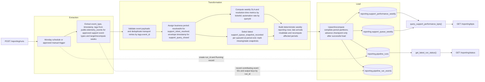

# Business Performance Data Pipeline Design

## Current State

Nexova's telemetry contract is defined in [`docs/telemetry/event-schemas.json`](../../docs/telemetry/event-schemas.json). It specifies a shared event envelope (`eventId`, occurrence `timestamp`, `sessionId`, `userId`, `event_type`, `schemaVersion`, `requestId`, and event-specific `properties`) and registered support events including `support_ticket_resolved`, `support_queue_snapshot_recorded`, and `support_query_closed`. The business-relevant event payloads are validated against that schema by the telemetry API.

The existing capture path is `POST /telemetry/events` in `services/telemetry-api`. It maps each event's `properties` into JSONB `tags` and stores the envelope's `eventId` as `tags.event_id`; the event type and occurrence timestamp are separate columns in `public.telemetry_events`. A unique index and conflict handling deduplicate repeat delivery by `tags.event_id`. The stored rows also contain service, level, and nullable value/message columns. They do not retain `requestId`, `sessionId`, `userId`, `schemaVersion`, or a received-at timestamp. See [`services/telemetry-api/app/routers/telemetry.py`](../../services/telemetry-api/app/routers/telemetry.py), [`services/telemetry-api/app/db.py`](../../services/telemetry-api/app/db.py), and [`services/telemetry-api/migrations/001_create_telemetry_events.sql`](../../services/telemetry-api/migrations/001_create_telemetry_events.sql).

The registered support events describe the domain data available to a business pipeline:

- `support_ticket_resolved` carries pseudonymous ticket/client IDs, channel, `openedAt`, `resolvedAt`, `resolutionSeconds`, the 86,400-second SLA target, and `slaMet`.
- `support_queue_snapshot_recorded` carries `queueId` and aggregate open, overdue, unassigned, agent, and oldest-ticket-age counts.
- `support_query_closed` carries pseudonymous `queryId`, automation eligibility, resolution method, handoff, and resolved outcome.

The repository defines and accepts these event types, but a code search found no support-event producer call sites and `data/raw/` contains only its README files. Therefore the repository confirms the event contract and ingestion capability, not that these event types have actually been emitted or that production records exist. Verify source availability and event volume in the configured runtime before treating any KPI as measured.

The existing engineering report remains separate. `GET /telemetry/report` in `services/telemetry-api` reads `public.telemetry_events` and returns a period plus three technical metrics implemented in [`services/telemetry-api/app/analysis.py`](../../services/telemetry-api/app/analysis.py):

- operational event counts grouped by UTC day and event type;
- HTTP 5xx rate grouped by request type (`method` and route template);
- average API latency grouped by UTC day, route template, and method.

The endpoint has a process-local 60-second cache and serves engineering diagnostics. Do not change this report, its analysis module, or its `/telemetry/report` endpoint for the business pipeline.

## Business Gap

The engineering report can show how many support-related events were recorded and whether APIs are slow or failing. It does not answer whether Nexova's Customer Support operation is meeting its 24-hour SLA, how resolution time compares with the stated 48-hour average, whether eligible queries are being resolved by the chatbot toward the 40% target, or what the support queues' backlog state is. Those are the approved business questions for Roberto Díaz's weekly Support rollup and Laura Mendoza's executive report, not engineering-health metrics.

Today, Laura receives weekly reports assembled manually by department heads, taking several hours per manager and arriving with stale information. The dedicated business pipeline will provide the approved Support rollup through separate `reporting` tables and `services/reporting/` endpoints. `public.telemetry_events` remains its source, never its destination; the technical report path continues unchanged.

## Purpose

Produce a weekly Customer Support performance rollup for Roberto Díaz and Laura Mendoza's weekly executive report, calculating 24-hour SLA attainment, average resolution time, eligible-query automation resolution, and week-end support backlog from `support_ticket_resolved`, `support_query_closed`, and `support_queue_snapshot_recorded`.

The rollup compares support outcomes with the 24-hour SLA and 40% automation target stated in `CONTEXT.md`; it reports the stated 48-hour current resolution average as context only, not as a pipeline-derived measurement. The KPI API serves the latest successfully materialized week. It does not claim real-time freshness; operational streaming use remains separate.

## KPI Definitions

All rates return their numerator and denominator alongside the percentage. An empty denominator produces `value: null` and `status: "no_data"`, never a numeric zero rate. Do not expose ticket, client, query, or source-event IDs in the KPI response.

- **24-hour SLA attainment:** `100 * sla_met_ticket_count / resolved_ticket_count`. From `support_ticket_resolved`, use distinct nonempty `ticketId` values per reporting week with `slaTargetSeconds == 86400` and a valid boolean `slaMet`. Deduplicate transport retries first by `eventId`; if multiple valid resolution events exist for one ticket in the week, use the latest `resolvedAt`. The numerator is tickets with `slaMet == true`; the denominator includes both true and false outcomes. Return a percentage and both counts.
- **Average resolution time:** `sum(resolutionSeconds) / resolution_sample_count`, reported in seconds and hours. Use the latest valid per-ticket resolution event for the reporting week and require finite, nonnegative `resolutionSeconds`. Return the sum and valid sample count. Compare the resulting hours with the 48-hour current average stated in `CONTEXT.md`, but do not use that baseline as a computed value.
- **Eligible-query automation resolution:** `100 * bot_resolved_eligible_query_count / eligible_query_count`. From `support_query_closed`, select the latest envelope-`timestamp` outcome for each `queryId` in the reporting week. The denominator is distinct queries with `eligibleForAutomation == true`; the numerator is the subset with `resolved == true` and `resolutionMethod == "bot"`. Return a percentage and both counts, and compare with the 40% target in `CONTEXT.md`.
- **Week-end support backlog:** a point-in-time value per observed `queueId`, not a weekly sum. Select the latest `support_queue_snapshot_recorded` at or before `period_end`; return `openTicketCount`, `overdueTicketCount`, `unassignedTicketCount`, `activeAgentCount`, and `oldestOpenAgeSeconds`, plus `snapshot_at`, `snapshot_age_seconds`, and freshness status. A snapshot older than five minutes is stale; missing/stale values are not represented as zero. Do not sum `activeAgentCount` across queues.

## Extraction Contract

- **Source:** PostgreSQL `public.telemetry_events`; it is read-only input for this pipeline. No other domain table is approved as a v1 source.
- **Selected columns:** `event_type`, `timestamp`, and `tags` (`JSONB`). Use the existing telemetry read grant for those columns; do not depend on `id`, which is not included in that grant. `tags` contains the event-specific properties plus `event_id`; nullable `value` and `message` are separate columns and are not inputs to these three approved event types.
- **Source filter:** restrict reads to `support_ticket_resolved`, `support_query_closed`, and `support_queue_snapshot_recorded`; extract only their approved payload fields. Conceptual query shape:

  ```sql
  SELECT event_type, timestamp, tags
  FROM public.telemetry_events
  WHERE event_type = ANY(:approved_support_event_types)
  ```

  Apply type-specific event-time bounds after validation: compare `tags.resolvedAt` with the UTC reporting-week bounds for resolved tickets; compare envelope `timestamp` with those bounds for closed queries; and select queue snapshots by envelope `timestamp` at or before the period end, retaining only an observation within five minutes of that boundary as fresh. Repeat these predicates for each of the five periods in the approved recomputation set.

- **Period:** a local reporting week is Monday 00:00 inclusive through the following Monday 00:00 exclusive in `Europe/Madrid`; convert both boundaries to UTC before querying/comparing stored timestamps. The scheduled run starts Monday at 06:00 `Europe/Madrid` and materializes the preceding completed week.
- **Event-time semantics:** for `support_ticket_resolved`, include the business resolution week using payload `tags.resolvedAt` and use `tags.resolvedAt` to select the latest resolution for a ticket. For `support_query_closed`, use the envelope `timestamp` as the close-event time because the payload has no close timestamp. For `support_queue_snapshot_recorded`, use the envelope `timestamp` as the snapshot time and select the latest snapshot at or before the period end; mark it stale when it is more than five minutes old at that boundary. Apply schema/type validation before accepting these fields.
- **Arrival/update behavior:** the source is append-oriented and unique on `tags.event_id`; retried delivery of the same event is ignored. The schema provides occurrence time but no `received_at`, and support-event producer call sites are not present in this repository. Do not treat an incremental event-time watermark as proof all earlier events arrived. Each Monday recomputes the new completed week plus the prior four completed weeks, comparing event-ID membership with prior successful lineage; older periods require explicit manual backfill.
- **Cadence/freshness:** support events are intended for streaming consumers, and queue snapshots may be published at most every 30 seconds with the latest queue state retained. This business pipeline runs weekly by approval, after the reporting week closes. Each published row must include its reporting period and successful generation/run metadata so the endpoint can expose freshness honestly.
- **Data limits:** source IDs are pseudonymous. Keep `ticketId`, `queryId`, and event IDs out of dashboard labels and aggregate responses. The stored schema does not retain `requestId` or a received-at timestamp. The user approved a restricted run-to-event lineage table using stored `tags.event_id`; do not promise request-level or ingestion-lag lineage.

## Data Flow



The report API is a consumer/control surface only. It invokes pipeline functions; source extraction, KPI transformation, and reporting-table writes remain owned by `data/pipelines/`.

## Mutable Sources, Duplicates, and Snapshot Replacement

`public.telemetry_events` is an append-only event store for this design; the approved source records are not updated in place. At ingestion, a retry with the same envelope `eventId` conflicts on the unique `tags.event_id` index and is ignored by `insert_telemetry_rows`. A later event with a different `eventId` is a distinct source row and must still be checked at the business grain:

- For weekly ticket KPIs, select at most one `support_ticket_resolved` row per `ticketId` using greatest `resolvedAt` within the reporting week, then calculate the approved numerator/denominator and average. This implements the confirmed once-per-ticket-per-week rule rather than treating event IDs as ticket IDs.
- For the automation rate, select at most one `support_query_closed` row per `queryId` in the week, using the latest envelope `timestamp` as the outcome. This implements the confirmed once-per-query-per-week rule; the schema has no close-cycle ID.
- Treat each `support_queue_snapshot_recorded` row as a replaceable observation, not an increment. For each `queueId`, choose the latest snapshot at or before `period_end`; store its values and `snapshot_at` in the row keyed by `(period_start, queue_id)`. On a rerun, upsert that same key with the recomputed latest observation and freshness state. Never add counts from successive snapshots. If there is no snapshot within the approved five-minute freshness window, set the state to stale/missing and do not present its values as current or substitute zero.

The weekly KPI result is similarly recomputed from source events and upserted by `period_start` in `reporting.support_performance_weekly`; the same run key updates its queue partitions rather than adding duplicate periods. No other mutable source table is in the approved v1 input. The exact transaction, partial-load rollback/retry, and concurrent-run lock behavior are specified in Task 3.2. If multiple distinct events for one ticket have an indistinguishable `resolvedAt` or conflicting payloads, record a data-quality exception rather than selecting an arbitrary business outcome.

## Idempotency at Ingestion and KPI Grain

Use separate idempotency keys at the appropriate layers:

- **Transport retry:** `eventId` is the envelope-level deduplication key. It is stored as `tags.event_id`, protected by a unique index, and duplicate inserts use `ON CONFLICT ... DO NOTHING`. A client retry after a timeout must reuse the original `eventId`; generating a new ID would make the delivery a distinct event.
- **Business aggregation:** `ticketId` and `queryId` are the approved once-per-week business keys for their respective metrics. `requestId` identifies/correlates the request that produced an event and is not the event retry key or business entity key; it is also not retained by current telemetry storage. Queue state is keyed by `(period_start, queue_id)`, not by count or event ID.
- **Reporting load:** each run deterministically recomputes its target week and upserts the KPI and queue partitions on their declared primary keys. Replaying a source set therefore replaces the same weekly rows rather than adding another copy. Task 3.2 defines transaction boundaries and the partial-load case.

The current `POST /telemetry/events` handler returns HTTP 200 with `received`, `stored`, and `rejected` counts after successful database access. A duplicate event is included in `rejected` because `stored` is lower than the number of valid rows; schema-invalid events also increment `rejected`, so the response does not distinguish “already stored” from invalid input. A persistence/database failure returns HTTP 503. Do not change this API in the business-pipeline design. Clients must inspect counts and preserve rejected rows for diagnosis; a 2xx response alone does not prove every event was stored. After an ambiguous timeout or 503, retry only ambiguous events with their original `eventId`; ingestion uniqueness prevents a second stored copy. The pipeline can only aggregate rows that were successfully stored and pass schema validation.

## Failure Recovery and Concurrent Runs

Each accepted execution receives a new UUID `run_id`. Before extraction, the flow acquires a PostgreSQL session advisory lock keyed by the pipeline name and UTC `period_start`; the lock-owning database session remains alive for the execution. Scheduled and manual triggers use the same flow and lock key. If the lock is already held, do not start a competing load; report the active run/period to the trigger caller. If the lock-owning connection is lost, abort the execution and do not continue to load without reacquiring the lock. The database releases the session lock when the connection closes.

The flow records durable phase checkpoints (`extract_complete`, `transform_complete`, `load_committed`) in `reporting.pipeline_runs`. Source reads and transformations are deterministic for the selected week and its approved late-event recomputation window. Intermediate in-memory data is not treated as durable: after a failed execution, a new `run_id` starts from extraction and recomputes the full target period. The failed run and its checkpoint/error remain in the audit log; the retry does not overwrite that run record.

Load the reporting outputs in one database transaction per reporting period. Within that transaction, replace the target week's `reporting.support_performance_weekly` row and all `reporting.support_queue_weekly` rows for that period with the complete recomputed result; insert the new run's `reporting.pipeline_run_events` lineage records; and set the run checkpoint/status to committed/completed. Unique keys (`period_start`, `(period_start, queue_id)`, `(run_id, event_id)`) provide a second duplicate barrier. Only after all output and lineage writes succeed does the transaction commit.

**Partial-load example:** if the database accepts 847 of 1,412 attempted output/lineage writes and then times out, the load transaction rolls back all writes and does not advance the checkpoint. When the database is reachable, the failure handler records the run as `Failed` at `load_pending`; if the outage prevents that update, the next run reconciles the stale `Running` record after confirming the old lock is gone. The next execution uses a new `run_id`, reacquires the period lock, rereads and recomputes the complete week, and atomically replaces the partitions. It cannot append a second copy, and a previous published week remains intact until the replacement transaction commits. The old run and its failure evidence remain auditable.

If any earlier implementation had committed partial chunks, the same full-period replacement transaction deletes/replaces the target partitions before inserting the complete recomputation. Keep prior run/event lineage as immutable audit history; only output partitions are replaced. Never mark `load_committed` or `Completed` before the transaction commits.

## Late Events and Corrections

By user approval, each Monday scheduled run examines the newly completed reporting week plus the prior four completed weeks. The stored event timestamp is occurrence time, not arrival time, so do not claim to measure ingestion delay or use a simple timestamp watermark to prove completeness. For each period, compare the current contributing `tags.event_id` set with the last successful `reporting.pipeline_run_events` lineage set for that output period. A newly stored event ID in a previously published period invalidates that period; recompute the entire period rather than incrementing its prior aggregate. The exact lookback is five weekly partitions total, including the newly completed week.

For every invalidated period, log the period bounds, reason (`late_source_event` or approved data-quality correction), new source event IDs/counts by type, prior successful `run_id` being superseded, and replacement `run_id`. Keep old `reporting.pipeline_runs` and `reporting.pipeline_run_events` rows as immutable audit history. Atomically replace only the affected output partition and write the new lineage records; the output's `run_id` identifies the latest successful materialization. A period in the lookback with no changed source-event set is audited as checked but need not be rewritten.

The source is append-only. A replay with the same `eventId` cannot correct its stored payload because ingestion ignores that conflict; any correction must arrive as a new event ID. The approved business-key rules then select the latest `resolvedAt` for a ticket and latest envelope `timestamp` for a query, while a later queue snapshot replaces the prior queue observation for the selected period. Conflicting distinct ticket events with equal `resolvedAt` are flagged for review, not silently chosen. Events older than the four-week lookback require an explicit manual backfill for their original week; that backfill uses the same period lock, full-period recomputation, unique new `run_id`, and retained audit history.

## Destination Tables and Lineage

All business outputs and pipeline audit data live in the approved `reporting` schema; `public.telemetry_events` remains read-only source data.

| Table                                  | Grain and key                                                                               | Planned contents                                                                                                                                                         |
| -------------------------------------- | ------------------------------------------------------------------------------------------- | ------------------------------------------------------------------------------------------------------------------------------------------------------------------------ |
| `reporting.support_performance_weekly` | One company-wide row per reporting week; primary/unique key `period_start`                  | `period_start`, `period_end`, SLA numerator/denominator/rate, resolution-time sum/sample count/mean, automation numerator/denominator/rate, `run_id`, and `generated_at` |
| `reporting.support_queue_weekly`       | One queue row per reporting week; composite primary/unique key (`period_start`, `queue_id`) | `period_start`, `period_end`, `queue_id`, queue counts/age, `snapshot_at`, `snapshot_age_seconds`, freshness state, `run_id`, and `generated_at`                         |
| `reporting.pipeline_runs`              | One record per flow execution; primary key `run_id`                                         | Trigger, source-period bounds, start/end, state, phase checkpoint, record counts, and sanitized error summary; detailed fields are specified in Execution Log            |
| `reporting.pipeline_run_events`        | One contributing source event per run; composite primary/unique key (`run_id`, `event_id`)  | `run_id`, stored source `event_id`, `event_type`, event timestamp, `period_start`, output table name, and output key (period key, plus `queue_id` for queue output)      |

Each KPI or queue output row carries `run_id` and reporting-period bounds, linking it to `reporting.pipeline_runs`. The lineage table links a run and each contributing `event_id` to the output table/key, so an auditor can reconstruct which event set produced a weekly aggregate without returning event IDs from the KPI API. Restrict lineage-table access to the pipeline/audit role and apply the approved retention policy; do not expose event-level IDs to dashboard consumers. The current telemetry store discards `requestId`, so request-level correlation is unavailable without a separately approved telemetry capture change; this design does not alter that path.

## Execution Log

`reporting.pipeline_runs` has one row per flow execution. Persist the initial row as soon as the period lock is acquired; update phase/heartbeat fields as the flow progresses. `ended_at` and error fields remain null until terminal state. The minimum audit fields are:

| Field                          | Type                                               | Why it is recorded                                                                                                                                                                                          |
| ------------------------------ | -------------------------------------------------- | ----------------------------------------------------------------------------------------------------------------------------------------------------------------------------------------------------------- |
| `run_id`                       | UUID, primary key                                  | Unique identifier for this execution and foreign key from its lineage/output rows.                                                                                                                          |
| `flow_name`                    | TEXT                                               | Identifies the pipeline when several jobs share the run log.                                                                                                                                                |
| `flow_version`                 | TEXT                                               | Identifies the design/code version needed to interpret a historical result.                                                                                                                                 |
| `trigger_source`               | TEXT (`schedule`, `manual`, `backfill`)            | Distinguishes scheduled work from operator-triggered reruns and backfills.                                                                                                                                  |
| `period_start`                 | TIMESTAMPTZ                                        | Identifies the inclusive beginning of the source/reporting window and lock partition.                                                                                                                       |
| `period_end`                   | TIMESTAMPTZ                                        | Identifies the exclusive end of the source/reporting window and makes reruns reproducible.                                                                                                                  |
| `started_at`                   | TIMESTAMPTZ                                        | Proves when execution began; compared with the expected Prefect schedule to identify a missing run.                                                                                                         |
| `ended_at`                     | TIMESTAMPTZ, nullable                              | Proves when a run reached a terminal state and supports duration/freshness reporting.                                                                                                                       |
| `status`                       | TEXT (`Running`, `Completed`, `Failed`, `Skipped`) | Distinguishes active, successful, failed, and lock-coalesced executions.                                                                                                                                    |
| `phase_checkpoint`             | TEXT                                               | Shows the last durable stage (`extract_complete`, `transform_complete`, `load_committed`) and where a new execution must replay.                                                                            |
| `heartbeat_at`                 | TIMESTAMPTZ, nullable                              | Shows the last flow progress update and identifies a stuck/stale `Running` execution.                                                                                                                       |
| `records_read`                 | BIGINT                                             | Measures source rows examined, including a healthy zero-row result.                                                                                                                                         |
| `records_validated`            | BIGINT                                             | Separates accepted source events from malformed/out-of-window rows.                                                                                                                                         |
| `rows_written`                 | BIGINT                                             | Audits the output volume and confirms whether the load stage produced rows.                                                                                                                                 |
| `source_event_counts`          | JSONB keyed by `event_type`                        | Compares event mix across runs and detects source-type gaps or unusual bursts.                                                                                                                              |
| `last_source_event_at_by_type` | JSONB keyed by `event_type`                        | Exposes source staleness/interval drift by event family without relying on an unavailable receive timestamp.                                                                                                |
| `source_heartbeat_at`          | TIMESTAMPTZ, nullable                              | Captures an independent telemetry producer/ingestion health signal; it is not present in the current event schema and must come from an external monitor. Null means source health is unknown, not healthy. |
| `supersedes_run_id`            | UUID, nullable                                     | Links a recomputation/backfill to the prior successful run for that period without deleting its audit record.                                                                                               |
| `error_code`                   | TEXT, nullable                                     | Provides a stable, searchable failure category without leaking infrastructure details.                                                                                                                      |
| `error_summary`                | TEXT, nullable, sanitized                          | Gives operators enough bounded context to diagnose the failure without credentials, payloads, or raw exception data.                                                                                        |

Interpretation rules: a `Completed` run with zero relevant rows is a successful empty extraction, not automatically proof of zero business activity. Only call it a true zero after the independent source heartbeat and any expected support-activity signal are healthy; otherwise set source/activity health to `unknown` and alert rather than publish zero. A missing run row for an expected scheduled period is detected by monitoring the Prefect deployment's expected start against the latest `started_at`; a row stuck in `Running` is detected by `heartbeat_at`. A failed run has `status=Failed`, an `error_code`, the failed phase checkpoint, and a terminal timestamp when the log database is reachable. The current telemetry contract has no heartbeat event, so capture-health monitoring is a prerequisite and an absent heartbeat must not be inferred from `support_queue_snapshot_recorded` alone.

## Observability and Operational Recovery

- **Two independent health signals:** Prefect monitors its expected Monday 06:00 `Europe/Madrid` schedule and alerts if no run record starts within the configured grace period; `heartbeat_at` alerts on a stale in-progress flow. Separately, an external support-event producer/ingestion health signal updates `source_heartbeat_at` and is monitored for silence. This source signal is not currently implemented or defined by an event in `docs/telemetry/event-schemas.json`; provide it outside `telemetry_events` before interpreting an empty extraction as true zero. A missing/stale source heartbeat means `unknown` and triggers an alert.
- **Zero activity versus capture failure:** A completed extraction with zero relevant events is only a confirmed zero when the database read succeeded and the independent source-health signal is fresh. Use `support_queue_snapshot_recorded.activeAgentCount` and observed queue snapshots as corroborating operational activity. If the source heartbeat is unavailable, or no queue snapshot arrives, do not claim zero business activity. `support_queue_weekly` includes only observed `queueId`s; without an approved queue registry, the system cannot name a queue that has never emitted or detect a specific unobserved queue as missing. Report this limitation rather than fabricating a zero row.
- **Growth, loss, gaps, and bursts:** Persist counts by event type and last event-time per type in `reporting.pipeline_runs`. Compare each period with the trailing four completed weeks for the same weekday/window, and compare support-ticket/query counts with observed `activeAgentCount`, queue IDs, and snapshot freshness. Alert on sustained or anomalous change using configurable thresholds; a volume change alone is not proof of growth or data loss. Queue snapshots older than the approved five-minute end-of-period threshold are stale. Resolution/query events have no promised periodic cadence, so use volume history plus the external source heartbeat rather than inventing a per-event schedule.
- **Event-to-report trace:** `reporting.pipeline_run_events` connects each contributing `event_id` and `event_type` to `run_id`, period, and output key; output rows carry that `run_id`. `requestId` is not present in the persisted source, so request-level correlation cannot be reconstructed. Keep event IDs and pseudonymous business IDs in restricted audit storage, not KPI API responses or dashboard labels.
- **Database/transmission retries:** On database connection errors, keep the last durable phase checkpoint, roll back the output transaction, and retry with bounded exponential backoff and jitter; after the configured attempt limit, mark the run `Failed` when the log store is reachable and alert. A later execution replays the period under the same period lock. Telemetry clients that time out or receive 503 retry the same event with the same `eventId`; a 2xx stops delivery retries even though the current API does not separate duplicates from invalid events in `rejected`.
- **Offline client buffering:** If an instrumented client must buffer events offline, use a bounded, expiring local queue (prefer IndexedDB over unbounded `localStorage`), assign and persist each `eventId` before queueing, and resend the same ID after reconnect. Store only schema-approved pseudonymous/aggregate fields, cap age and size, and surface expired/dropped event counts to telemetry health monitoring. Client buffering improves delivery but does not own deduplication; the server's unique event-ID index remains authoritative.
- **Concurrent scheduled/manual runs:** Both triggers enter the same Prefect flow and the same period-scoped database advisory lock. A busy lock reports the active run/period instead of racing another load. Each accepted execution has its own `run_id`; a lock loser does not overwrite the active run or its checkpoint.

## Prefect Flow and Tasks

The main Prefect flow is `support_performance_flow(period_start, period_end, trigger_source)`, implemented in the proposed `data/pipelines/support_performance.py`. The scheduled deployment supplies the latest completed week plus its four-week lookback; an authorized manual backfill supplies explicit period bounds to this same flow. The flow creates a unique `run_id`, acquires the reporting-period lock, writes the run-start record, and invokes the tasks in order:

| Prefect task                | Input                                                                           | Output                                                                                                                            | Durable checkpoint                                                                              |
| --------------------------- | ------------------------------------------------------------------------------- | --------------------------------------------------------------------------------------------------------------------------------- | ----------------------------------------------------------------------------------------------- |
| `extract_support_events`    | UTC period bounds, approved event-type allowlist, telemetry-read database block | Validated source rows with `event_type`, `timestamp`, `tags`, extracted `event_id`, and per-type read/validation counts           | `extract_complete`; includes the full recomputation window and does not advance by insertion ID |
| `transform_support_metrics` | Extracted rows and reporting period/timezone rules                              | Company weekly KPI row, latest observed queue rows with freshness states, source-to-output lineage records, and event-type counts | `transform_complete`; output is deterministic for the same source event set                     |
| `load_reporting_partitions` | Fully transformed KPI/queue rows, lineage records, `run_id`, period bounds      | Atomically replaced reporting partitions and committed run/checkpoint record                                                      | `load_committed`; only after the load transaction commits                                       |

The flow releases the advisory lock after success or failure. A failed execution does not pass in-memory task output to a later run; the next execution begins at extraction and recomputes the complete target week/lookback set. Part 1 uses one main flow; it does not require separate backfill flow or stage subflows.

## Prefect States and Retry Behavior

| Prefect state | Run-log behavior                                                                                                                                                                                                                                           | Pipeline behavior                                                                                                                                                                                                                                                             |
| ------------- | ---------------------------------------------------------------------------------------------------------------------------------------------------------------------------------------------------------------------------------------------------------- | ----------------------------------------------------------------------------------------------------------------------------------------------------------------------------------------------------------------------------------------------------------------------------- |
| `Running`     | After acquiring the period lock, create `reporting.pipeline_runs` with `status=Running`, `started_at`, `run_id`, period bounds, trigger source, and initial checkpoint. Update `heartbeat_at` and the durable phase checkpoint after each successful task. | Execute extraction, transformation, and load in order. A competing schedule/manual trigger for the same period observes the active run and does not start a parallel load.                                                                                                    |
| `Completed`   | Set `status=Completed`, `ended_at`, final counts, and `phase_checkpoint=load_committed`.                                                                                                                                                                   | Set only after the output, lineage, and completion record commit atomically. The KPI API then treats this run as the latest successful publication.                                                                                                                           |
| `Failed`      | Set `status=Failed`, `ended_at` when possible, the last durable checkpoint, and a sanitized `error_code`/summary. If the run-log database is unavailable, reconcile the stale `Running` record after the lock is released and connectivity returns.        | Roll back an incomplete load. Retry only transient database/connection failures using the configured bounded backoff; validation/data-contract errors fail without retry. A later execution receives a new `run_id` and deterministically replays the period from extraction. |

Prefect task retries are safe because source extraction is read-only and the load transaction replaces unique reporting partitions rather than incrementing them. A manual trigger and the scheduled deployment call the same flow and period-scoped PostgreSQL advisory lock. If the lock is held, the trigger is coalesced/reported against the active `run_id`; a lock loser does not alter its status or checkpoint. A database outage during the lock session aborts the flow; the next attempt must reacquire the lock before any writes.

## Prefect Blocks and Deployment Configuration

- **`telemetry_read_database` connection block:** PostgreSQL connection for `public.telemetry_events`, limited to `SELECT event_type, timestamp, tags`. The existing `telemetry_ingest` role also has `INSERT`; implementation should prefer a dedicated SELECT-only reader role rather than granting pipeline code ingest permissions. Store its DSN/password in a Prefect `Secret` block, not in flow parameters or source.
- **`reporting_database` connection block:** PostgreSQL connection that owns the `reporting` schema and the four approved output/audit tables. Use write credentials scoped to those reporting objects only; if source and destination share a database instance, retain distinct reader and writer credentials. Store credentials in a separate `Secret` block.
- **`support_source_health` configuration block:** Provider-neutral URL/identifier and polling configuration for the user-approved external support producer/ingestion health signal. If the monitor is authenticated, store its token in a `Secret` block. Its source/provider is not present in the repository; wire it before claiming source silence can be distinguished from true zero activity.
- **Schedule and timezone:** Configure the Prefect deployment for cron `0 6 * * 1` with timezone `Europe/Madrid`. Keep this non-secret schedule in deployment configuration and pass the period bounds into `support_performance_flow`; use the same flow for manual/backfill runs.
- **Alert credentials:** If deployment notifications use a webhook/email provider, store the token/connection in a Prefect `Secret` or provider connection block. The provider is not specified here; do not hard-code credentials or invent a vendor.

No object-storage block is needed for v1 because task outputs are recomputed from the source rather than relying on durable in-memory artifacts. The PostgreSQL advisory lock remains a database coordination primitive, not a credential/configuration block.

## Reporting Service Endpoint Contracts

The new FastAPI module lives under `services/reporting/`, separate from `services/telemetry-api/`. These are business-reporting endpoints; they never query `telemetry_events` directly and never expose ticket/query/event IDs or the run-event lineage table. Read endpoints require authenticated internal access; manual execution is restricted to authorized operators.

| Endpoint                | Request                                                                                                                                                                                                                         | Response and behavior                                                                                                                                                                                                                                                                                                                                                                                    |
| ----------------------- | ------------------------------------------------------------------------------------------------------------------------------------------------------------------------------------------------------------------------------- | -------------------------------------------------------------------------------------------------------------------------------------------------------------------------------------------------------------------------------------------------------------------------------------------------------------------------------------------------------------------------------------------------------- |
| `GET /reporting/status` | No body.                                                                                                                                                                                                                        | Returns latest run status, `run_id`, period bounds, checkpoint, last successful publication time, latest completed period, and source-health/freshness state (`healthy`, `silent`, or `unknown`). Before any run exists, report `not_run`; do not synthesize a successful status.                                                                                                                        |
| `POST /reporting/runs`  | Optional `period_start` and `period_end`; require both or neither. If omitted, use the latest completed Monday-to-Monday week. Explicit bounds must represent a whole `Europe/Madrid` reporting week and are normalized to UTC. | On accepted trigger, return `202 Accepted` with the new `run_id`, status, and period bounds. If the period lock is held, return the active run/period as a coalesced/conflict response; do not launch a second load. Supports an explicitly authorized older-period backfill through the same flow.                                                                                                      |
| `GET /reporting/kpis`   | Optional paired `period_start`/`period_end`; optional `queue_id`. If omitted, query the latest successfully published period.                                                                                                   | Returns period bounds/timezone, `generated_at`, `run_id`, weekly SLA numerator/denominator/rate, resolution-time sum/sample count/mean in seconds and hours, eligible-query automation numerator/denominator/rate, and observed queue snapshot values/freshness. A zero denominator returns null with `no_data`; an unpublished requested period returns `not_published`, never fabricated zero metrics. |

`GET /reporting/status` and `GET /reporting/kpis` expose aggregate business data only. The KPI response may contain the registered `queue_id` dimension but not pseudonymous ticket/client/query identifiers, source event IDs, credentials, or raw event payloads. The weekly API freshness is the latest successful materialization, not a real-time guarantee.

## Endpoint-to-Pipeline Boundary

The service imports only these application-facing functions from the proposed `data/pipelines/support_performance.py` module:

| Endpoint                | Pipeline function                                                                     | Responsibility boundary                                                                                                                                                                                                                                                                                             |
| ----------------------- | ------------------------------------------------------------------------------------- | ------------------------------------------------------------------------------------------------------------------------------------------------------------------------------------------------------------------------------------------------------------------------------------------------------------------- |
| `GET /reporting/status` | `get_latest_run_status()`                                                             | Reads `reporting.pipeline_runs` and external source-health state; returns status/freshness metadata. It does not read or aggregate source events.                                                                                                                                                                   |
| `POST /reporting/runs`  | `trigger_support_performance_flow(period_start, period_end, trigger_source="manual")` | Submits the approved Prefect deployment with normalized period bounds and returns its UUID as the canonical `run_id`. It does not run ETL inside the request handler. A preflight detects an active same-period run; the database advisory lock remains the race-safe authority and coalesces any concurrent loser. |
| `GET /reporting/kpis`   | `query_support_performance_kpis(period_start, period_end, queue_id=None)`             | Reads already materialized rows from `reporting.support_performance_weekly` and `reporting.support_queue_weekly`, returning the approved response shape. It does not read `telemetry_events` or recalculate KPIs.                                                                                                   |

`services/reporting/` is limited to authentication/authorization, parameter validation and normalization, calling these functions, and HTTP response/error mapping. Extraction, schema validation, deduplication, period recomputation, KPI calculations, lineage writes, and reporting-table transactions belong only to `data/pipelines/`.

## Separation from Technical Telemetry Reporting

This business pipeline is additive and independent. It reads `public.telemetry_events` as a source but writes only to the approved `reporting` tables. `services/telemetry-api/app/analysis.py`, the existing telemetry router, technical response/cache behavior, and `GET /telemetry/report` remain unchanged and continue to answer engineering questions. The new status/trigger/KPI routes live only under `services/reporting/`; they do not call the technical report endpoint or return its metrics. All approved business KPI fields already exist in the registered support event payloads, so this design proposes no telemetry payload/schema extension. If later validation finds a missing field, propose an additive capture-contract change separately; never change the engineering report or use `telemetry_events` as the business destination.
